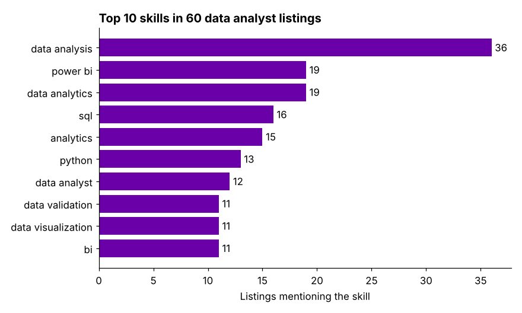

# JobPulse: What Skills Do Data Analyst Jobs Ask For?

A Python web-scraping pipeline that collects data analyst job listings from **Naukri.com**, India's largest job portal, turns them into a clean dataset, and measures which skills employers ask for most.



## Approach

The notebook follows an **extract → transform → analyse** pipeline:

1. **Extract:** Selenium (with webdriver-manager) loads each search-results page for "data analyst" jobs, since the listings are rendered with JavaScript. BeautifulSoup then parses the HTML.
2. **Transform:** for each listing, it pulls the **title, company, experience required, location, salary and skill tags** into a pandas DataFrame.
3. **Clean:** removes duplicate listings (same title, company and location), and standardises location names.
4. **Analyse:** counts how often each skill appears across listings, and which cities have the most openings.

## Results

From 60 unique data analyst listings:

- **Core analysis skills come first.** "Data analysis" appears in 36 listings, more than any specific tool.
- **Power BI (19) is asked for more often than SQL (16) or Python (13)**, which suggests many analyst roles are reporting-focused.
- **Data quality matters too:** data validation (11) appears as often as data visualisation (11).

## Repository

| File | What it is |
|---|---|
| `Web Scrapping- Naukri.com.ipynb` | Scraper, cleaning and analysis |
| `figures/top_skills.png` | Chart of the skill counts from the notebook's output |

[View the notebook on nbviewer](https://nbviewer.org/github/tisyavaidya/Web-Scrapping--Naukri.com/blob/main/Web%20Scrapping-%20Naukri.com.ipynb)

## Run it yourself

```bash
pip install selenium webdriver-manager beautifulsoup4 lxml pandas matplotlib
jupyter notebook "Web Scrapping- Naukri.com.ipynb"
```

Chrome needs to be installed. Results will differ from run to run, since listings change daily. Please scrape responsibly: keep request rates low and respect the site's terms of use.

## Next steps

- Scrape more pages and other roles (data scientist, ML engineer) to compare skill demand
- Track listings over time to see which skills are rising
- Parse salary ranges and relate them to skills and experience

## Tools

Python, Selenium, BeautifulSoup, pandas, Matplotlib

---

[Tisya Vaidya](https://tisyavaidya.com) · [LinkedIn](https://www.linkedin.com/in/tisya-vaidya/) · [GitHub](https://github.com/tisyavaidya)
